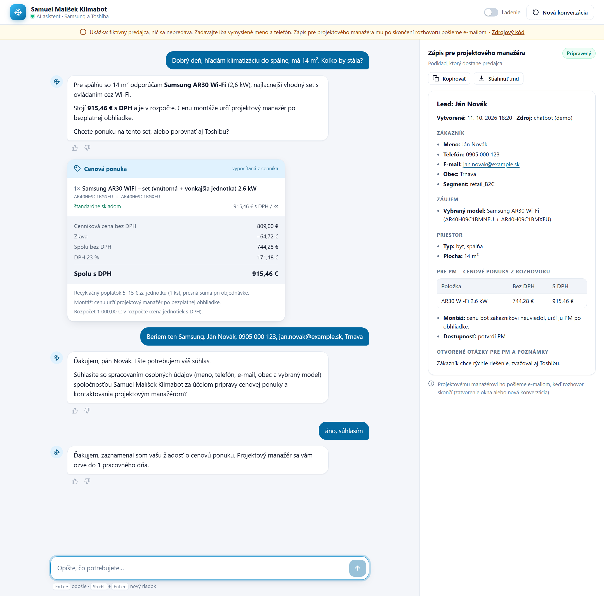

# Klimabot — AI sales assistant for air conditioning

A Slovak-language chatbot that sells air conditioning the way a good salesperson does. It asks about the space first, recommends a specific Samsung or Toshiba model, quotes an exact price, and hands a structured brief to the project manager once the customer agrees.

**Live demo:** _link coming soon_ (the bot speaks Slovak; use made-up contact details)



On the left, the conversation: the recommendation, a price card computed by the server from the price list, and the consent question. On the right, the brief the project manager receives once the customer agrees. The **Ladenie** switch also shows the bot's notes about the customer and its tool calls.

## Why

I wasn't happy with the chatbots on Slovak AC retailers' websites, so I built my own. It's built around the discovery questions a salesperson would ask: type of space, m², number of rooms, and budget last.

## Keeping an LLM honest about prices

Most of the work went into stopping the model from making things up. In early tests it told a customer that 2 930 € fits "under your 2 000 € budget", and it invented a discount before looking one up. So:

- **The model never touches a price.** It calls a `quote` tool with model codes and quantities only. Python looks up the catalog prices, pairs indoor and outdoor units into sets, checks multi-split compatibility, applies the discount policy (one discount per product category, the same for both brands, plus customer segment and promotion), and returns line items with stock availability ([`stock_policy.json`](config/stock_policy.json)), totals, VAT, the recycling fee, the comparison with the customer's budget (on their basis: with VAT unless they said without), the difference to earlier quotes and a cheaper suitable set when there is one. Ambiguous codes return an error instead of a guess.
- **No installation price.** Installation depends on the site, so the bot never states a figure: the project manager prices it after the free site visit. When the customer's budget includes installation, the bot can only say whether the units fit.
- **`quote` also checks that the set fits the space.** If the customer named a server room, salon or medical practice, residential units are refused; a server room needs two independent systems, each sized for the stated heat load with a margin, plus the failover controller. The thresholds live in [`sizing_policy.json`](config/sizing_policy.json). Softer mismatches (undersizing, a Wi-Fi wish on a model without Wi-Fi) come back as warnings, with the cheapest set that does have Wi-Fi.
- **Every euro amount in a reply must come from `quote`.** The validator compares each amount in the bot's answer with what `quote` returned, the euro amounts the customer typed, and differences between quote totals. A number from anywhere else, like an estimate, a self-computed discount or a catalog price copied from search results, gets the reply regenerated (at most twice per turn); if it is still there, the sentence is cut out before the customer sees it. The pricing policy isn't even in the prompt, so there are no percentages to apply by hand.
- **Every response is checked server-side before the customer sees it.** Text the model writes next to a tool call ("let me check…") isn't shown at all; the answer comes after the tool. Mechanical issues (headings, emoji spam, Czech words) are fixed in place; content issues that sit in one sentence (a price under the wrong product or with the wrong VAT label, invented model codes or spec figures, savings claims, permit promises, delivery dates, asking where the outdoor unit goes) are regenerated or cut out; the rest is logged. The conversation history keeps exactly what was shown.
- **Consent is decided by code, not by the model.** When the bot asks for contact details, code appends the GDPR question in its approved wording ([`consent_phrases.json`](config/consent_phrases.json)). The bot asks for contact details (name, phone, e-mail, town) only after it has given a price. Only an explicit yes in the customer's very next message counts; "OK", "beriem" or "súhlasím s cenou" don't, and the question is asked again (at most twice). The bot doesn't handle complaints: it collects no personal data and gives the company's e-mail and phone instead. Until consent, phone numbers, e-mails and known names are masked in every log event; after a refusal, the whole session log is scrubbed.
- **It stays in its lane.** Off-topic questions (medicine, law, homework, recipes) get one polite sentence and a way back to air conditioning, and the bot says it's an AI when asked. When a customer reports smoke, sparks or a burning smell, the reply opens with "switch it off at the breaker, call 112 if something is burning" — code adds it if the model doesn't. Diagnoses like asthma never reach the project manager's brief.
- **Leads are guarded.** `capture_lead` refuses to save anything without recorded sales consent, and refuses model codes that never came up in the conversation. If the customer consents but the bot forgets to close, code captures the lead itself. The audit in `cost_report.py` checks the order question → yes → lead independently of the bot.
- **Tested.** [`tests/`](tests/) covers these guarantees with a fake model client; [`eval/`](eval/) runs scripted customer conversations end to end and checks every quoted price against the raw price lists.

## How it works

- **Model:** Claude Haiku 4.5 with tool use (`search_knowledge`, `lookup_product`, `quote`, `check_compatibility`, `compare_products`, `update_customer_state`, `capture_lead`, `request_human_handoff`), with prompt caching on the static system prompt.
- **Retrieval:** hybrid BM25 (with diacritics-folded tokens and a SK/CZ/EN synonym glossary) plus `multilingual-e5-base` embeddings, fused with reciprocal rank fusion and re-ranked by a multilingual cross-encoder. HyDE query expansion runs for vague questions.
- **Behavior rules** live as Markdown files in [`knowledge/rules/`](knowledge/rules/). Each one states the rule, why it exists (usually a real failure), and how to apply it. They're retrieved like knowledge, with a small authority boost.
- **Web UI:** Flask + server-sent events, one HTML file with no build step. Replies render as sanitized Markdown, the empty chat offers example questions, a status line says what the bot is doing while it prepares a reply ("Počítam cenu…"), and the PM record can be copied or downloaded. Light and dark themes, a tabbed layout on phones. marked and DOMPurify are pinned local copies (no CDN), and the page is served with a Content-Security-Policy. Each browser tab gets its own session, so concurrent visitors never share a conversation.
- **Analytics:** [`cost_report.py`](cost_report.py) reports cost per session and per lead, the conversion funnel, drop-off points, which rules the validator catches most often, and a GDPR consent audit over the JSONL logs.

## Repository layout

```
bot.py            the whole bot in one file (also the CLI: python bot.py)
main.py           starts the web app
cost_report.py    cost, conversion and GDPR-audit report over the logs (also at /admin)
config/           pricing policy, consent wording, sizing thresholds, stock rules, model prices
knowledge/        what the bot searches: samsung/, toshiba/, montaz/ (price lists), rules/ (behavior rules)
web/              the web app: web.py and static/ (one HTML file + pinned marked and DOMPurify)
tests/            unit tests with a fake model client
eval/             scripted customer conversations, runners and analysis
docs/             screenshot
data/             runtime output, gitignored: logs, sessions, leads, PM briefs, caches
Dockerfile, docker-compose.yml, Makefile    Docker (make build / web / down)
Caddyfile                                   HTTPS on a server (compose profile https)
```

## Data

[`knowledge/samsung/`](knowledge/samsung/) and [`knowledge/toshiba/`](knowledge/toshiba/) hold the real product data: the full Samsung (RAC, FJM multi-split, CAC commercial) and Toshiba (RAS, RAV) lineups with about 500 model codes, specs and list prices. I transcribed it into my own JSON structure, with Slovak descriptions, glossaries and index guides, from the manufacturers' publicly available price lists:

- **Samsung:** Cenník Samsung Chladenie 2026, 1st edition, prices valid from 1 Jan 2026, © Samsung Electronics Air Conditioner Europe B.V. ([PDF](https://www.climaport.sk/wp-content/uploads/2026/06/Cennik-Samsung-Chladenie-2026.pdf))
- **Toshiba:** Toshiba produktový katalóg 2026–2027 (SK), prices valid 1 Apr 2026 – 31 Mar 2027, via the Slovak distributor AIR-COND International

Prices are informative list prices excluding VAT (DPH) and recycling fees, as of those editions. They change, and the official price lists are what counts. This project isn't affiliated with Samsung or Toshiba, and all trademarks belong to their owners.

Not real: [`knowledge/montaz/`](knowledge/montaz/) is a small sample of an installation-materials price list with made-up prices, and the pricing policy in [`discounts.json`](config/discounts.json) is illustrative (a uniform 10 % discount). The "shop" in the demo is fictional.

## Run it locally

```bash
bash setup_project.sh                 # creates .venv and installs dependencies
source .venv/bin/activate             # Windows Git Bash: source .venv/Scripts/activate
cp .env.example .env                  # then put your ANTHROPIC_API_KEY in .env
python main.py                        # web UI on http://127.0.0.1:5000
python bot.py                         # or chat in the terminal
```

The first run downloads the embedding model and the cross-encoder (~750 MB).

Set the company contact the bot gives to customers (complaints, a refused consent, a closed conversation) in `.env`: `COMPANY_EMAIL` (default `info@klimabot.example`) and `COMPANY_PHONE`. Without `COMPANY_PHONE` the bot offers only the e-mail, it never makes up a number.

### Running it as a public demo

The web app is a public demo, so its limits are on by default (`KLIMABOT_DEMO=0` turns them off for local debugging). Set `HOST=0.0.0.0` / `PORT` for your hosting platform. Run a single worker process, because sessions and counters live in memory.

Costs are capped in USD, priced from `model_prices.json`. A "network" is one IPv4 address or one IPv6 /64.

| Variable | Default | Purpose |
|---|---|---|
| `KLIMABOT_SESSION_USD_CAP` | 0.50 | one conversation (also in the CLI); when it is used up, the bot closes the conversation with a recap of the last quote and the company contact |
| `KLIMABOT_TURN_USD_CAP` | 0.40 | one customer message (also in the CLI) |
| `KLIMABOT_IP_DAILY_USD` | 2.00 | per network per day (UTC) |
| `KLIMABOT_DAILY_USD_BUDGET` | 5.00 | all visitors together per day (UTC); saved in `.demo_spend.json`, so a restart doesn't reset it |
| `KLIMABOT_MAX_TURNS` | 25 | messages per conversation |
| `KLIMABOT_MAX_MESSAGE_CHARS` | 800 | max message length |
| `KLIMABOT_SESSIONS_PER_IP_HOUR` | 20 | new conversations per network per hour (Reset counts too) |
| `KLIMABOT_MESSAGES_PER_IP_MINUTE` | 15 | messages per network per minute |
| `KLIMABOT_TURNS_IN_FLIGHT_PER_IP` | 2 | replies being prepared at once per network |
| `KLIMABOT_MAX_CONCURRENT_TURNS` | 6 | replies being prepared at once in total |
| `KLIMABOT_REPO_URL` | — | adds a source-code link to the demo banner |
| `KLIMABOT_ADMIN_TOKEN` | — | turns on `/admin` (the cost report, today's spend, leads, reply feedback); log in with any user name and this token as the password |
| `KLIMABOT_TRUSTED_PROXIES` | 0 | number of reverse proxies in front (1 on a Hugging Face Space); only then is `X-Forwarded-For` trusted for the per-network limits |

These limits are a first line of defense. Give the demo its own Anthropic Console workspace with a monthly spend limit, and set the organization's own spend limit below the tier's cap. When either limit is hit, the bot stops calling the API and answers with the company contact (the breaker is saved in `.spend_breaker.json`).

### Docker

```bash
cp .env.example .env                  # ANTHROPIC_API_KEY, plus SMTP_* and LEAD_MAIL_TO for lead e-mails
make build                            # docker compose build
make web                              # start it and wait until it answers: http://127.0.0.1:7860
make down                             # stop it (the data volume stays)
```

Without `make`, run the `docker compose` commands from the [`Makefile`](Makefile) directly.

The build installs the CPU-only PyTorch, puts both HuggingFace models into the image and embeds the knowledge base, so a new container is ready in about 20 seconds instead of downloading and embedding first. The first build takes about 20 minutes (most of it installing PyTorch), the image is about 4.7 GB and the container needs 2–3 GB of RAM.

- Everything the bot writes (logs, leads, sessions, the spend and mail ledgers) goes to the `klimabot-data` volume at `/data` (`KLIMABOT_DATA_DIR`), so a restart or redeploy keeps the daily budgets and the leads. The cost report runs inside: `docker compose exec klimabot python cost_report.py`.
- Secrets come from `.env` when the container starts; `.dockerignore` keeps the file out of the image.
- The port is published on 127.0.0.1 only; the internet comes in through a reverse proxy (see below). Compose sets `KLIMABOT_TRUSTED_PROXIES=1`, so the per-network limits see the visitor's address, not the proxy's.
- `docker compose down` and redeploys stop the app with SIGTERM: open conversations are ended and their leads e-mailed first (`stop_grace_period: 60s`).
- Run one container. Sessions and counters live in its memory, so it can't be scaled out.

#### On a server

The recommended public setup: one Linux VPS with 2+ vCPU and 4+ GB RAM (the image needs about 15 GB of disk to build), Docker with the compose plugin, and a domain. The `caddy` service in [`docker-compose.yml`](docker-compose.yml) puts HTTPS in front of the app ([`Caddyfile`](Caddyfile)) and gets the Let's Encrypt certificate itself.

1. Point the domain's DNS (an `A` record, plus `AAAA` for IPv6) at the server. Without a domain, a free [DuckDNS](https://www.duckdns.org) subdomain works: set its IP to the server's and use `<name>.duckdns.org` as the domain. If it is behind Cloudflare, use DNS only (grey cloud): its proxy cuts requests after 100 s, and a reply may take up to 180 s.
2. Open ports 22, 80 and 443 (TCP, and 443/UDP for HTTP/3) in the firewall. Docker publishes its ports past `ufw`, which is fine here: only 80 and 443 are published to the internet.
3. On the server, `git clone` the repo, `cp .env.example .env` and set `ANTHROPIC_API_KEY`, `COMPOSE_PROFILES=https`, `KLIMABOT_DOMAIN`, `COMPANY_EMAIL`, `KLIMABOT_ADMIN_TOKEN`, and for lead e-mails the `SMTP_*` / `LEAD_MAIL_TO` settings (optional; without them leads stay in the data volume and `/admin`). Use SMTP port 587: many hosts block 25 and 465.
4. `make build`, then `make web`. The site is at `https://<KLIMABOT_DOMAIN>` once Caddy has the certificate (a few seconds); `/admin` shows the spend and the leads.

To deploy a change: `git pull`, `make build`, `make web` (the app restarts; Caddy answers "starting" for about a minute). Certificates are kept in the `caddy-data` volume. Logs: `docker compose logs -f klimabot caddy`.

#### On a Hugging Face Space

Create a Docker Space, push the repo and add `sdk: docker` and `app_port: 7860` to the YAML header of the Space's README. Put `ANTHROPIC_API_KEY` (and the SMTP settings) in the Space's secrets and set the variable `KLIMABOT_TRUSTED_PROXIES=1`. Without persistent storage the Space's disk is wiped on every restart: leads still reach the PM by e-mail, but the daily spend ledger starts over, so the spend limit of the demo's Anthropic Console workspace is what really caps the cost. With persistent storage, it is mounted at `/data`, where the image already writes. Outbound SMTP from Spaces has been reported to time out, so don't count on lead e-mails there.

### E-mailing leads to the project manager

When a conversation that produced a lead is finished, the bot e-mails its handoff brief to the PM: one plain-text mail per conversation, with the final version of the lead. "Finished" means the visitor closed the tab or pressed Reset, wrote nothing for `KLIMABOT_IDLE_MINUTES` (30), the app shut down, or, in the CLI, typed `bye`. Put these in `.env` (see `.env.example`); mailing is off until `SMTP_HOST` and `LEAD_MAIL_TO` are set.

| Variable | Default | Purpose |
|---|---|---|
| `LEAD_MAIL_TO` | — | the PM's e-mail address (several: comma-separated) |
| `SMTP_HOST` / `SMTP_PORT` | — / 587 | your mail server; 587 uses STARTTLS, 465 uses SSL (`SMTP_SECURITY` overrides) |
| `SMTP_USER` / `SMTP_PASSWORD` | — | login; use an app password |
| `LEAD_MAIL_FROM` | `SMTP_USER` | sender address |
| `LEAD_MAIL_MAX_PER_DAY` | 30 | caps the mails a public demo can send |
| `LEAD_MAIL_MAX_PER_NETWORK_DAY` | 3 | mails per visitor network per day |

A failed send is retried twice and then logged (`lead_mail_failed`, also counted by `cost_report.py`); the lead itself is always saved in `leads.jsonl` and `handoff_records/`. Mail goes only to `LEAD_MAIL_TO`, never to an address typed in the chat.

On a public page anyone can type someone else's phone number, so the PM gets at most one mail per contact per week, and demo leads are marked: the subject starts with `[DEMO]` and the mail opens with a warning that the details may be made up.

### Customer view

Visitors see only the chat and the PM record. The **Ladenie** switch in the header shows what the bot does behind the scenes: tool calls, server notices and its notes about the customer. It is off by default in the demo and on with `KLIMABOT_DEMO=0`; `?debug=1` in the URL turns it on.

In the chat, a reply that quotes a price gets a price card computed by the server (list price, discount in % and €, totals with and without VAT, availability, recycling fee) with a "Toto chcem" button that sends the choice as the customer's message, the consent question gets "Áno, súhlasím" / "Nie, nesúhlasím" buttons that send those exact words, and every reply can be rated 👍 / 👎 (counted by `cost_report.py`, with the replies rated down). Reloading the page keeps the conversation; closing the tab ends it after 20 seconds.

### Measuring cost on the real API

`eval/run_eval.py --api` runs the scripted conversations against the Anthropic API with the production caps and stops starting new ones at `--budget-usd` (default $10). Each conversation costs at most $0.50:

```bash
python eval/run_eval.py --api --run-dir eval/runs/api_run --scenarios "scenarios/round2_*.json" scenarios/abuse.json
python eval/analyze.py eval/runs/api_run      # cost per conversation, cache share, conversations that hit the cap
```

## Author

Samuel Malíšek, QA automation engineer — [LinkedIn](https://www.linkedin.com/in/samuel-malisek/)
