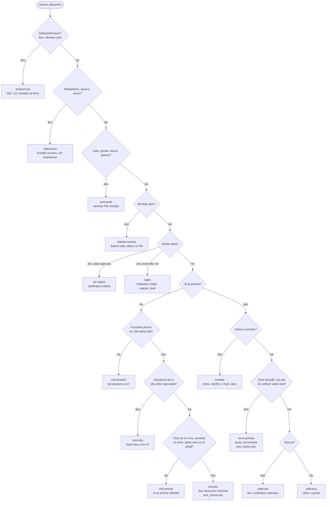

# Conversation policy: where the next reply heads

Every customer message gets exactly one **move**, decided by code in `bot.py` (`next_move()`, section "Conversation policy") before the model writes anything. The move's directive is the first line of the server context ("ĎALŠÍ KROK"), so the model gets one direction instead of a pile of notes it may weigh differently each time. The move is fixed for the whole turn (`Session.turn_move`), so a quote made mid-turn doesn't change it before the reply is written. For an offer move the turn's first model call must call a tool (`tool_choice: any`). Each turn logs a `policy_move` event.

The checks run top to bottom; the first one that applies decides.

**Decline wrapper.** When the latest message asks about something the company doesn't offer or the price lists don't know — instalments or leasing, photovoltaics, a technology no file mentions (Siri, HomeKit) — the move becomes `neponukame`: the one-sentence answer, then "Potom:" and the sales move the diagram would have chosen, so the conversation keeps going.

| move | when | what the reply does |
|---|---|---|
| `bezpecnost` | danger in the latest message (`_DANGER_RE`) | safety steps first (code also prepends them), nothing sold, the company contact |
| `reklamacia` | `_support_case()` | the company contact; no personal data asked, nothing promised |
| `priemysel` | `_industrial_case()` | no design or price; the PM designs it — contact, or name and phone as a condition |
| `vlastna-montaz` | the customer installs a unit themselves | no advice; the PM or the company contact |
| `zapis` / `po-zapise` | sales consent recorded, lead not yet / already written | only the missing contact details, `capture_lead`; afterwards follow-up questions |
| `zisti-priestor` | no m², kW or code yet | the type of space and its m², at most two questions, no prices |
| `zisti-izby` | a multi-room flat or house without an answer about the rooms | which rooms and their m² |
| `zisti-priority` | size known, no price question, no wish, not asked yet | one question about what matters |
| `ponuka` | the first offer is due (`_offer_due`, a price question or wishes known) | two options, each priced by `quote` (code-picked sets when `_suggested_sets` finds them; multi-split for 2–5 rooms) |
| `kontakt` | an offer exists and the customer picked one | the contact request; code appends the consent question |
| `nova-ponuka` | a cheaper / other series / other size / a code after an offer | quote it, compare with `comparison_with_earlier_quotes` |
| `odpoved` | a question after an offer | the answer from tool results only, then back to the offer |
| `pokracuj` | anything else after an offer | short, towards the choice |

The output gate still checks every reply; the moves make the first draft head the right way, and the gate demands a price (`cena-neodpovedana`) only on `ponuka` and `nova-ponuka` turns.

## Measured (2026-10-27)

`eval/stability.py`: six scripted conversations (a bedroom price, a two-room flat, a vague start, photovoltaics, picking the cheaper offer, a filter question after an offer), three times each through the real API, with the direction of each reply read by code. Baseline: branch `klimabot-upgrade` at `82d525d`, without the policy.

| | baseline | policy |
|---|---|---|
| replies heading where they should | 76 % | 94 % |
| the three repeats head the same way | 45 % | 82 % |
| regenerations per turn | 0.88 | 0.58 |
| model calls per turn | 3.1 | 2.7 |
| seconds per turn | 11.2 | 9.3 |
| USD per conversation | 0.028 | 0.023 |

The two policy replies counted off target are classifier misses (a rooms question written without a question mark, a filter answer ending with "which one?"); read by hand, all 33 turns head the right way. `cena-neodpovedana` (asked instead of pricing) went from 21 regenerations to none. The direction classifier was refined once after the first run, for both versions alike (declines worded as "nie je súčasť nášho portfólia", a first question about the type of space that also mentions rooms). What still regenerates is content, not direction: unsupported claims in offers (`nepodlozene-udaje`), tykanie (`vykanie`), amounts not from `quote`.

Since 2026-10-28 every commit is measured on the conversations of `eval/scenarios/direction.json` through the Claude Code CLI (not the paid API): `python eval/stability.py --history` shows the trend, `--commit <sha>` measures one commit, `--install-hook` turns on the per-commit run. The table above came from the API with an earlier version of the script, so it isn't comparable with the history rows.
